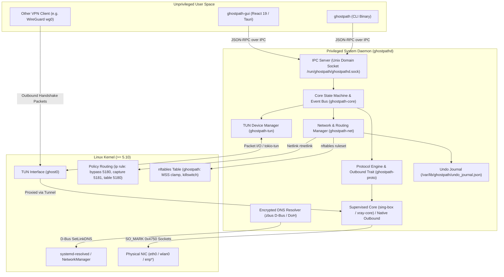
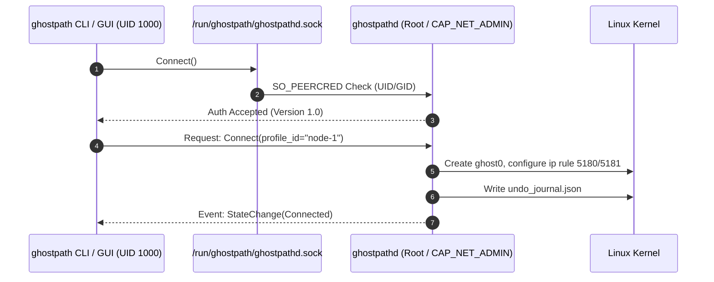

# GhostPath VPN Architecture Specification (ARCHITECTURE.md)

## 1. Executive Summary

**GhostPath VPN** is a native Linux VPN client written in Rust designed specifically to provide reliable full-system TUN mode connections on heavily filtered networks (such as Iran and similar censored environments). It natively supports V2Ray-family protocols (VLESS + Reality, VMess, Trojan, Shadowsocks) and solves two primary failure classes inherent to existing Linux clients:

1. **Multi-VPN Coexistence & Chaining:** Seamless operation alongside or underneath other VPN clients (WireGuard, OpenVPN, Tailscale), allowing other VPNs to establish tunnels *through* GhostPath without routing loops or connection drops.
2. **Deterministic Linux Network Stack Control:** Defeating the common causes of Linux TUN failure: routing loops, default route hijack race conditions, systemd-resolved and NetworkManager DNS hijacking/poisoning, IPv6 leaks, MTU/MSS fragmentation stalls, and Docker iptables conflicts.

---

## 2. High-Level Architecture Diagram



---

## 3. Cargo Workspace Crate Structure

The repository is organized into a modular Cargo workspace:

| Crate | Responsibility | Dependencies |
| :--- | :--- | :--- |
| `ghostpath-core` | Core state machine (`Disconnected`, `Connecting`, `Connected`, `Degraded`, `Failed`), configuration models, event bus (`tokio::sync::broadcast`), credentials & paths. | `serde`, `tokio`, `thiserror`, `tracing` |
| `ghostpath-proto` | V2Ray link parsers (`vless://`, `vmess://`, `trojan://`, `ss://`), subscription parsers, config generator for sing-box/xray, `trait Outbound`, and child process supervisor. | `url`, `base64`, `serde_json`, `tokio`, `regex`, `thiserror` |
| `ghostpath-tun` | TUN interface creation (`ghost0`), non-blocking packet polling via Tokio, userspace IP stack (`ipstack`/`smoltcp`) translation of layer-3 packets to layer-4 TCP/UDP streams. | `tun-rs`, `tokio`, `bytes`, `ipstack`, `smoltcp` |
| `ghostpath-net` | Linux networking primitives: policy routing rules, routing tables, and interface addresses via `rtnetlink`; nftables table management; DNS resolution via `zbus` (systemd-resolved); atomic `/var/lib/ghostpath/undo_journal.json` transaction engine and RAII cleanup guards. | `rtnetlink`, `netlink-packet-route`, `zbus`, `nftables`, `serde_json` |
| `ghostpath-daemon` | The privileged background service `ghostpathd`. Manages Unix domain socket IPC, client authentication via `SO_PEERCRED`, lifecycle supervision, and watchdog. | `tokio`, `clap`, `nix`, `tracing-subscriber`, all above crates |
| `ghostpath-cli` | The command-line interface `ghostpath` with subcommands: `connect`, `disconnect`, `status`, `import`, `doctor`, `logs`. | `clap`, `tokio`, `serde_json`, `tabled`, `colored` |
| `ghostpath-gui` | Desktop frontend wrapper and IPC bridge for the React UI located in `UI/`. | `tauri`, `serde`, `tokio` |

---

## 4. Network Design & Linux Subsystem Interactions

### 4.1 Routing Loop Prevention
A fundamental flaw of naive VPN clients on Linux is capturing their own outbound proxy connection:
1. The proxy process opens a TCP connection to the remote server `198.51.100.1:443`.
2. The VPN client sets the default route to interface `ghost0`.
3. The proxy's TCP SYN packet is routed right back into `ghost0`, causing an immediate infinite routing loop.

**GhostPath Solution:**
- Every socket created by the outbound proxy engine is stamped with socket mark `SO_MARK = 0x4750`.
- An explicit policy routing rule is inserted with Netlink:
  ```text
  ip rule add fwmark 0x4750/0x4750 table main priority 5180
  ```
- Traffic generated by the proxy matches this rule and bypasses `ghost0`, routing directly out the physical gateway via table `main`.
- We **never** rely on static `/32` routes to the server IP, because CDN-fronted, Cloudflare, and domain-fronted configurations rotate destination IPs continuously.

### 4.2 Split Default Route & Policy Routing Hierarchy
To capture system traffic into `ghost0` without destructively overwriting the kernel's default route:
- GhostPath uses a dedicated routing table `5180`:
  ```text
  ip route add default dev ghost0 table 5180
  ip rule add not fwmark 0x4750/0x4750 table 5180 priority 5181
  ```
- Alternatively, split default routes (`0.0.0.0/1 dev ghost0`, `128.0.0.0/1 dev ghost0`) can be placed in table `5180`.
- Priority `5181` leaves all lower priority values open for local lookups, and leaves room for foreign VPN interfaces to insert their own rules.

### 4.3 Multi-VPN Coexistence & Chaining
- **Chaining WireGuard over GhostPath:**
  When a user starts `ghostpathd`, `ghost0` captures default traffic. When the user subsequently launches `wg-quick up wg0`, WireGuard's outbound UDP handshake packets (to its remote endpoint) match rule `5181`, entering `ghost0` and tunneling through GhostPath to exit in Europe/US. Inside Linux, `wg0` becomes the innermost interface. GhostPath's rules do not intercept or flush `wg0`'s routes.
- **Interface & Subnet Exclusions:**
  `ghostpath-net` dynamically inspects interface events. Interfaces matching exclusions (`docker0`, `br-*`, `virbr*`, `wg*`, `tailscale*`) and RFC1918 private subnets (`10.0.0.0/8`, `172.16.0.0/12`, `192.168.0.0/16`) are bypassed by default.

### 4.4 DNS Management & Leak Elimination
1. **systemd-resolved Active:**
   Connect via D-Bus (`zbus`) to `org.freedesktop.resolve1.Manager`.
   - Call `SetLinkDNS(ifindex, [10.8.0.1])`
   - Call `SetLinkDomains(ifindex, [("~.", true)])`
   - The `"~."` (routing domain) forces systemd-resolved to route 100% of system DNS lookups exclusively through `ghost0`.
2. **Direct `/etc/resolv.conf`:**
   Atomic backup to `/var/lib/ghostpath/resolv.conf.backup`. Point `nameserver` to `127.0.0.1:10853` (GhostPath internal DNS proxy) or tunnel DNS.
3. **nftables Anti-Leak:**
   Port 53 and 853 UDP/TCP packets exiting any interface other than `ghost0` or matching the proxy fwmark are blocked.

### 4.5 MTU and MSS Clamping
- `ghost0` MTU is set to `1420`.
- In filtered network environments, intermediate middleboxes drop fragmented packets.
- `ghostpath-net` adds an nftables rule to clamp TCP MSS:
  ```text
  table inet ghostpath {
      chain forward {
          type filter hook forward priority -150; policy accept;
          tcp flags syn tcp option maxseg size set rt mtu - 40
      }
  }
  ```

---

## 5. Security & Privilege Architecture



- **Unprivileged Clients:** The CLI and GUI run as ordinary users without `sudo`.
- **Peer Credentials:** IPC connections are verified via `getsockopt(..., SO_PEERCRED)`. Access is restricted to `root` and members of the `ghostpath` Unix group.
- **Systemd Hardening:** `ghostpathd.service` specifies:
  - `NoNewPrivileges=true`
  - `ProtectSystem=strict`
  - `ProtectHome=read-only`
  - `CapabilityBoundingSet=CAP_NET_ADMIN CAP_NET_RAW CAP_NET_BIND_SERVICE`
  - `AmbientCapabilities=CAP_NET_ADMIN CAP_NET_RAW CAP_NET_BIND_SERVICE`
